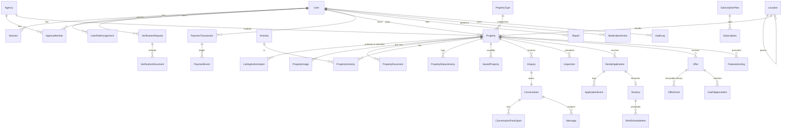

# Sukkot Salone — Implementation Plan

This document answers the "first task" of the master specification: the stack,
MVP scope, architecture, data model, routes, components, design system,
security checklist, roadmap and external services. It is kept up to date as
phases land; see `docs/DEVLOG.md` for what has actually been built and verified.

Working brand: **Sukkot Salone** ("Trusted homes, land and spaces across Sierra
Leone"). The name, tagline, logo text and contact details are configurable in
`apps/web/src/config/brand.ts` and through the `system_settings` table.

---

## 1. Technology stack

| Layer | Choice | Why |
|---|---|---|
| Monorepo | pnpm workspaces (`apps/web`, `apps/mobile`, `packages/shared`) | One repo, one set of validation rules shared by web, API and mobile. |
| Web + API | **Next.js 15 (App Router) + TypeScript** | Server rendering for SEO on public listings, route handlers for the JSON API, one deployable unit (spec Option A). |
| Database | **PostgreSQL 16 + Prisma 6** | Relational integrity, migrations, typed queries, transactions. |
| Styling | Tailwind CSS 4 with a small in-repo component kit (shadcn-style, Radix-free to keep bundles small) | Consistent design tokens, no runtime CSS-in-JS cost on slow connections. |
| Motion | Framer Motion (restrained, honours `prefers-reduced-motion`) | Page/section reveals, card hovers, modal transitions. |
| Icons | lucide-react / lucide-react-native | One consistent icon family on web and mobile. |
| Forms | React Hook Form + Zod (schemas from `@sukkot/shared`) | The same Zod schema validates in the browser, in the API and in the app. |
| Charts | Recharts | Dashboard charts from real aggregates. |
| Auth | First-party session auth: bcrypt password hashes, opaque random session tokens stored hashed in `sessions`, HttpOnly cookie on web, `Authorization: Bearer` on mobile | One auth model for both clients, revocable sessions, no third-party dependency. |
| Files | Storage driver interface: local private disk in development, S3-compatible (Cloudflare R2 / AWS S3 / Backblaze) in production. Images resized to WebP with `sharp`. Private documents only via short-lived HMAC-signed URLs. | Cheap, portable, no sensitive file ever in a public directory. |
| Payments | Provider abstraction with **Orange Money**, **Afrimoney**, bank transfer, card (placeholder), manual and cash recording, plus a sandbox provider for development | Mobile money first, as requested; nothing is marked paid without a verified callback or a provider status query. |
| Mobile | **Expo SDK 54 + Expo Router + React Native** | Android-first (dominant in Sierra Leone) and iOS from one codebase; consumes the same `/api/v1`. |
| Tests | Vitest (unit + DB integration), Playwright (end-to-end, desktop and mobile viewports) | Fast, TypeScript-native. |
| Deploy | Vercel or Render for web/API, Neon/Render/Supabase Postgres, R2/S3 storage, EAS Build for mobile | Free tiers available during development. |

We deliberately do **not** run two backends: the mobile app talks to the
Next.js API.

## 2. MVP scope vs later enhancements

**MVP (this repository)**

- Public marketplace: home page, search with server-side filters persisted in
  the URL, grid/list views, property detail pages, location pages, agents
  directory, compare, favourites, share, report listing.
- Accounts: register, sign in, sign out, password reset tokens, roles
  (tenant/buyer, owner/landlord, agent, admin sub-roles), profile settings.
- Listings: create/edit with category-specific fields, image upload with
  resizing, private document upload, draft → submitted → published flow,
  pause/remove, status history.
- Communication: enquiries that open a property-linked conversation, private
  messaging with unread counts, in-app notifications, block/report users.
- Inspections: request, confirm/reschedule/decline/cancel, conflict prevention
  for the same listing representative, Africa/Freetown display.
- Rentals: configurable rental terms per listing, rental applications with the
  full status machine, tenancy record on completion, rent payment records.
- Sales: offers and counteroffers as immutable events, negotiation timeline,
  land due-diligence checklist, legal notices.
- Trust: five separate verification tracks, evidence uploads, verification
  officer queue, badges only when verified, reports and fraud workflow.
- Admin: overview, listing moderation with mandatory reasons, verification
  queue, reports, users and roles, locations, categories/amenities, plans,
  payments, settings, audit log.
- Payments: provider abstraction, Orange Money + Afrimoney adapters, signed
  webhooks, idempotency keys, ledger events, manual/cash/bank recording that is
  clearly labelled "recorded, not verified".
- Mobile app: browse/search/filter, property detail with gallery, favourites,
  sign in/register, enquiries, messaging, inspection requests, offers,
  my activity.

**Later enhancements**

- Live merchant onboarding with Orange Money SL and Africell Afrimoney (code is
  ready; credentials and final endpoint specs are required).
- SMS (e.g. Africa's Talking) and WhatsApp Business notifications.
- Map search with tiles (OpenStreetMap/MapLibre) and polygon drawing.
- E-signature of agreements, identity-verification provider (e.g. Smile ID).
- Krio translation, saved-search alert emails on a schedule, push notifications.
- Agency team permissions beyond owner/manager/agent, commission statements.
- Offline-first caching in the mobile app.

## 3. System architecture

```mermaid
flowchart LR
  subgraph Clients
    B[Browser - Next.js pages]
    M[Expo mobile app]
  end
  subgraph Next.js app (apps/web)
    RSC[Server components<br/>public pages, dashboards]
    API[/api/v1 route handlers/]
    SVC[Service layer<br/>src/server/services]
    AUTH[Auth + RBAC]
    PAY[Payment providers]
    STO[Storage driver]
  end
  DB[(PostgreSQL)]
  OBJ[(Object storage<br/>public images / private docs)]
  OM[Orange Money API]
  AM[Afrimoney API]
  MAIL[Email provider]

  B --> RSC
  B --> API
  M --> API
  RSC --> SVC
  API --> AUTH --> SVC
  SVC --> DB
  SVC --> STO --> OBJ
  SVC --> PAY
  PAY --> OM
  PAY --> AM
  OM -- signed callback --> API
  AM -- signed callback --> API
  SVC --> MAIL
```

All business rules live in `src/server/services`. Route handlers only parse
input with the shared Zod schemas, resolve the session, and call a service with
an explicit `actor`. Server components call the same services for reads, so a
permission rule exists in exactly one place.

## 4. Entity-relationship overview

The full schema is `apps/web/prisma/schema.prisma`. Core relationships:



Key modelling decisions:

- **Separate status concepts** on `Property`: `listingStatus` (draft, pending
  review, published, paused, rejected, suspended, removed, expired),
  `availability` (available, under offer, rented, sold, unavailable),
  `verificationStatus` (documents reviewed or not). Transactions have their own
  status on `Offer` / `RentalApplication`.
- **Money** is stored as `BigInt` minor units plus an explicit ISO currency
  (`SLE`, `USD`). No floats anywhere; no silent conversion.
- **Category-specific attributes**: common columns for searchable facts
  (bedrooms, bathrooms, floor area, plot size) are nullable; the property type
  declares which fields are required; long-tail attributes go in a validated
  `attributes` JSON column.
- **Locations** are one self-referencing hierarchy table (province → district
  → city/town → locality) maintained by admins.
- Timestamps are UTC (`timestamptz`); rendering uses `Africa/Freetown`.

## 5. Route map

Public (server-rendered, indexable):
`/`, `/properties`, `/properties/[slug]`, `/locations`, `/locations/[slug]`,
`/agents`, `/agents/[id]`, `/compare`, `/list-your-property`, `/verification`,
`/safety`, `/help`, `/privacy`, `/terms`, `/sitemap.xml`, `/robots.txt`.

Auth: `/auth/sign-in`, `/auth/sign-up`, `/auth/forgot-password`,
`/auth/reset-password`.

Account dashboard (`/dashboard`, any signed-in user, sections shown by role):
overview, `properties`, `properties/new`, `properties/[id]`, `enquiries`,
`messages`, `messages/[id]`, `inspections`, `applications`,
`applications/[id]`, `offers`, `offers/[id]`, `tenancies`, `payments`,
`saved`, `notifications`, `verification`, `agency`, `billing`, `settings`.

Admin (`/admin`, admin roles only): overview, `listings`, `verification`,
`reports`, `users`, `agencies`, `locations`, `catalog` (types, amenities),
`plans`, `payments`, `content`, `settings`, `audit`.

JSON API (`/api/v1`, used by the web client components and the mobile app):
`auth/*`, `me`, `meta`, `locations`, `properties`, `properties/[id]`,
`properties/[id]/images`, `properties/[id]/documents`,
`properties/[id]/status`, `favorites`, `saved-searches`, `enquiries`,
`conversations`, `conversations/[id]/messages`, `inspections`,
`inspections/[id]`, `applications`, `applications/[id]`, `offers`,
`offers/[id]`, `offers/[id]/events`, `due-diligence/[id]`, `reports`,
`notifications`, `verification`, `files/[...key]`, `payments`,
`payments/webhooks/[provider]`, `admin/*`.

## 6. Component inventory

`ui/`: Button, IconButton, Input, Textarea, Select, Checkbox, Label, Field,
Badge, Card, Dialog, Sheet (mobile bottom sheet), Tabs, Toast, Skeleton,
EmptyState, Pagination, Stat, Timeline, Tooltip, Money, DateTime.

`property/`: PropertyCard (grid + list), PropertyGallery (full-screen viewer,
swipe), PropertySpecs, AmenityList, VerificationBadges, FavoriteButton,
ShareButton, CompareToggle, ReportDialog, EnquiryForm, InspectionForm,
OfferForm, ApplicationForm, SafetyNotice, PriceTag.

`search/`: SearchPanel (hero), FilterSidebar / FilterSheet, SortSelect,
ViewToggle, ActiveFilterChips.

`layout/`: AnnouncementBar, SiteHeader (desktop nav + mobile drawer),
SiteFooter, DashboardShell (sidebar + mobile tab bar), AdminShell, Reveal
(IntersectionObserver reveal).

`dashboard/`: StatCards, Charts (enquiries/views/income), tables that collapse
to stacked cards on small screens.

## 7. Visual design system

- **Colours**: navy `#0B1F3A` (primary), emerald/teal `#0F766E` (secondary,
  success/verified), warm gold `#C8962E` (accent, featured), neutrals from
  `#F7F8FA` to `#111827`. Destructive `#B42318`. Contrast checked to WCAG AA
  for text on each surface.
- **Type**: "Plus Jakarta Sans" for UI and body, "Fraunces" for display
  headings, loaded via `next/font` with `swap`.
- **Shape**: 12px card radius, 10px controls, soft two-layer shadows, 1px
  hairline borders.
- **Spacing**: 4px scale; section padding 64–96px desktop, 40–56px mobile.
- **Imagery**: 4:3 card images, 16:9 detail hero. Demo listings use
  illustrative artwork that is labelled as such; no stock photo is presented as
  a real property.
- **Motion**: 150–250ms ease-out; card lift 2px with image zoom 1.04; section
  reveal fade+8px rise once; all disabled under reduced motion.

## 8. Security and privacy checklist

- [x] Passwords hashed with bcrypt (cost 12); generic sign-in errors.
- [x] Opaque session tokens, stored as SHA-256 hashes; HttpOnly, Secure,
      SameSite=Lax cookies; sessions revocable; suspended users blocked.
- [x] CSRF: state-changing cookie-authenticated requests must be same-origin
      (Origin/Host check) and JSON; bearer requests are not cookie-bound.
- [x] Every API handler resolves the actor server-side; role, price, owner and
      IDs from the client are never trusted.
- [x] Object-level authorization on conversations, documents, offers,
      applications, inspections (participants or authorised staff only).
- [x] Rate limiting on auth, enquiries, messages and reports.
- [x] Zod validation on all inputs; React output encoding; no
      `dangerouslySetInnerHTML` with user content.
- [x] Uploads: MIME sniffing by magic bytes, size limits, images re-encoded,
      private documents never in a public path, short-lived signed URLs.
- [x] Audit log for privileged actions; moderation decisions require reasons.
- [x] Payment webhooks verified by HMAC signature, idempotent by provider
      reference, amounts re-checked against the stored transaction.
- [x] Contact details and exact coordinates hidden unless the owner opts in.
- [x] Security headers (CSP, HSTS in production, frame-ancestors none,
      referrer policy, permissions policy).
- [ ] Malware scanning of uploads (interface present; needs a provider).
- [ ] External penetration test before launch.
- [ ] Legal review of tenancy, land and data-protection wording by Sierra
      Leonean counsel (flagged in `docs/LEGAL_REVIEW.md`).

## 9. Phased roadmap

| Phase | Scope | State |
|---|---|---|
| 1 | Requirements, architecture, schema, design system | Done (this document) |
| 2 | Foundation: monorepo, Next.js, Tailwind, Prisma, migrations, seed, auth | Done |
| 3 | Public marketplace: home, search, detail, locations, agents, SEO | Done |
| 4 | Accounts and listings: profile, RBAC, listing forms, uploads, publishing | Done |
| 5 | Enquiries, messaging, inspections, notifications, reporting | Done |
| 6 | Rental applications, offers/counteroffers, due diligence, tenancies, payment records | Done |
| 7 | Admin: moderation, verification, reports, audit, analytics | Done |
| 8 | Payments: abstraction, Orange Money, Afrimoney, sandbox, subscriptions, promotions | Interfaces and sandbox done; live providers need merchant credentials |
| 9 | QA: unit, integration, end-to-end, accessibility and security review | Core suites in place; see `docs/TESTING.md` |
| 10 | Deployment docs, env templates, backup and recovery | Documented in `docs/DEPLOYMENT.md` |
| — | Mobile app (Expo) on the same API | MVP screens done |

## 10. External services needing registration or approval

| Service | Purpose | What is needed |
|---|---|---|
| Orange Money Sierra Leone (Orange Developer "Orange Money Web Payment") | Mobile money collection | Merchant account, client ID/secret, merchant key, callback URL whitelisting |
| Africell Afrimoney | Mobile money collection | Merchant onboarding and the merchant API specification/credentials |
| Bank (e.g. Rokel, SLCB, Ecobank, UBA SL) | Bank transfer reconciliation | Account details for manual reconciliation; API if offered |
| Card acquirer (optional) | Card payments | Not wired; requires a PCI-compliant hosted checkout |
| Email (Resend, Postmark, SES or SMTP) | Verification, reset, notifications | API key, verified sending domain |
| SMS / WhatsApp (Africa's Talking, Twilio, WhatsApp Business) | Optional alerts | Account, sender ID approval |
| Object storage (Cloudflare R2 / S3) | Images and private documents | Bucket, access keys |
| Postgres host (Neon, Render, Supabase) | Database | Connection string, backups |
| Expo / EAS, Google Play, Apple App Store | Mobile builds and publishing | Developer accounts |
| Maps (OpenStreetMap/MapLibre, optional Google Maps) | Map search | Tile provider or API key |
| Identity verification (optional, e.g. Smile ID) | ID checks | Commercial agreement |
